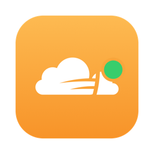
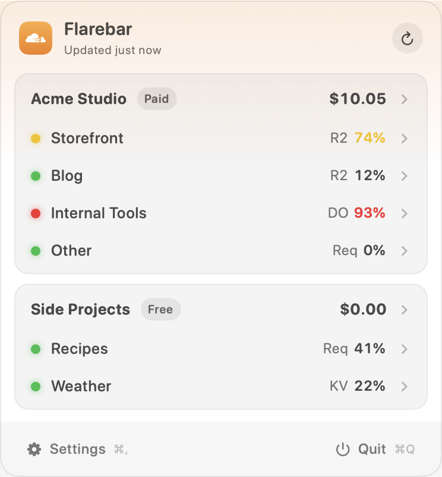
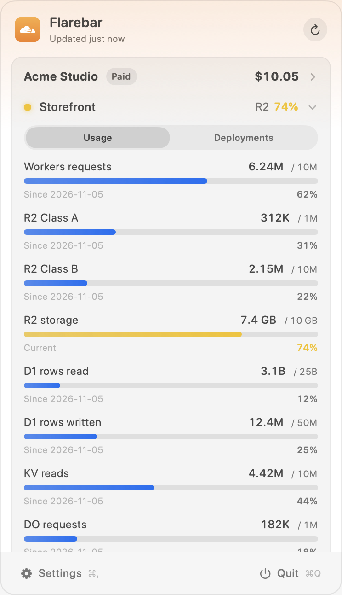
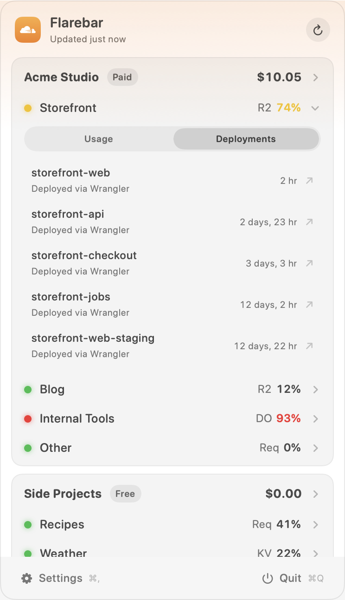
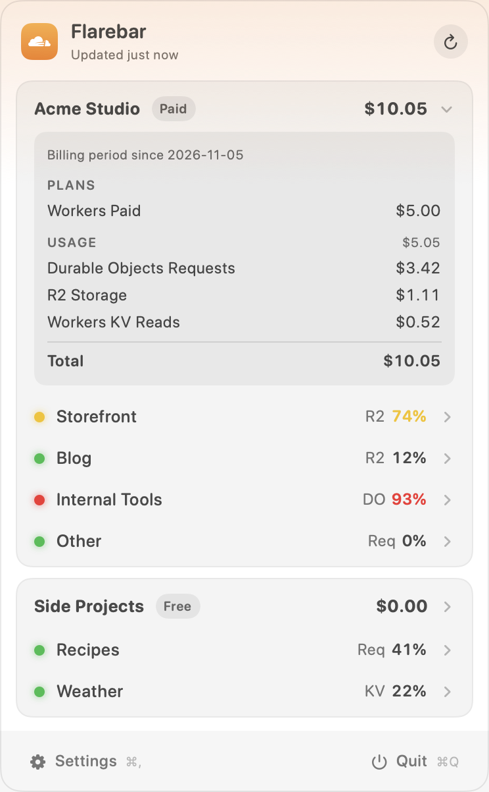
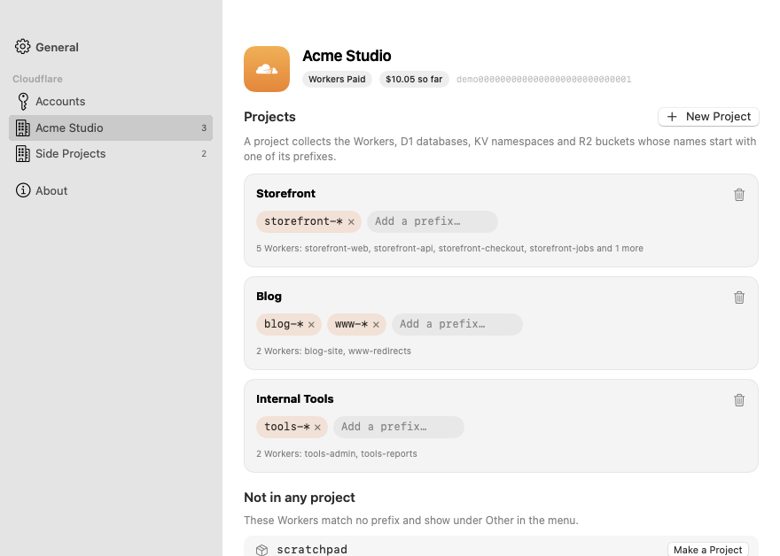

<p align="center">
  
</p>

<h1 align="center">Flarebar</h1>

<p align="center">
  Cloudflare in your Mac's menu bar: usage against your plan's allowances, the bill so far,<br>
  and Worker deployments, grouped by project across accounts.
</p>

<p align="center">
  
</p>

Cloudflare's dashboard shows usage per account. If one account holds several projects, it
does not tell you which of them is using the allowance. Flarebar groups your Workers, D1
databases, KV namespaces, R2 buckets and Durable Objects into projects by name prefix, and
shows each project's share.

Version 0.1.0. A personal tool, not affiliated with or endorsed by Cloudflare.

## What it shows

| Usage | Deployments | Bill |
| --- | --- | --- |
|  |  |  |

- **A status dot per project**, and one on the menu bar icon for the worst of them: green,
  yellow above 70% of an allowance, red above 90%. Both levels can be changed.
- **Usage**: Workers requests, R2 Class A and Class B operations, R2 storage, D1 rows read
  and written, KV reads, and Durable Object requests, each against the account's allowance.
- **Deployments**: a project's Workers, newest first, with the client that last deployed
  each one. A click opens the Worker in the Cloudflare dashboard.
- **Bill**: what the account owes so far this billing period, split into paid plans and
  metered usage per billed line.
- **Other**: whatever in the account matches no project, so nothing goes unseen.

The screenshots show invented data.

## Requirements

- macOS 15 or later.
- Xcode, for its Swift toolchain. There is no download; you build it yourself.
- A Cloudflare API token with read-only permissions (see below).

## Install

```sh
git clone https://github.com/akiarostami/flarebar.git
cd flarebar
./scripts/build-app.sh
open ~/Applications/Flarebar.app
```

The script builds a release, assembles `~/Applications/Flarebar.app` and signs it. Flarebar
has no Dock icon; look for the cloud in the menu bar.

## Set up

Click the icon, then **Settings**.

1. Open **Accounts** and press **Add Account…**.
2. Press **Create a Token on Cloudflare**. Cloudflare's form opens with these permissions
   ticked, all Read:

   | Permission | Needed for |
   | --- | --- |
   | Account Analytics | all usage figures (required) |
   | D1, Workers KV Storage, Workers Scripts | resource names, and the list of Workers |
   | Billing | the bill and the Workers plan (optional) |

   Under Account Resources, include the accounts you want, then create the token.
3. Paste the token. Flarebar verifies it, saves it to your Keychain, and adds the accounts it
   can reach. One token can cover several accounts, and you can add more tokens.
4. Each account gets its own page in Settings. Create projects there and give each one or
   more name prefixes.

<p align="center">
  
</p>

### How projects work

A project is a name plus one or more prefixes. A resource belongs to a project when its
name starts with one of them:

| Resource | Name that is matched |
| --- | --- |
| Worker | the script name |
| D1 database | the database name |
| KV namespace | the namespace title |
| R2 bucket | the bucket name |
| Durable Object namespace | the name of the Worker that defines it |

A resource that matches two projects counts in both. Workers that match none are listed on
the account's page with a **Make a Project** button.

### How the figures are measured

Allowances belong to the account, so a project's bar is that project's share of the
account's allowance. Which allowance applies depends on the account's Workers plan, which
Flarebar reads from its subscriptions.

| Figure | Workers Paid, per billing period | Workers Free |
| --- | --- | --- |
| Workers requests | 10M | 100K a day |
| R2 Class A operations | 1M | 1M a month |
| R2 Class B operations | 10M | 10M a month |
| R2 storage | 10 GB | 10 GB |
| D1 rows read | 25B | 5M a day |
| D1 rows written | 50M | 100K a day |
| KV reads | 10M | 100K a day |
| Durable Object requests | 1M | 100K a day |

Daily figures cover the current UTC day. Without the Billing permission the bill is blank
and the monthly window is the calendar month. These allowances are written into the app
(`Sources/FlarebarCore/PlanLimits.swift`); if Cloudflare changes them, that file needs
updating.

Flarebar refreshes when you open the menu (at most once a minute), every 10 minutes, and on
demand. The last good data is kept on disk and shown when Cloudflare cannot be reached.

## Keyboard

Set a system-wide shortcut under **Settings → General** to open the menu from any app.
With the menu open:

| Key | Action |
| --- | --- |
| ↑ ↓ | Move between rows |
| → / ← | Open / close the selected row |
| ⌘→ / ⌘← | Switch an open project between Deployments and Usage |
| Return or Space | Open or close the selected row |
| ⌘, | Settings |
| ⌘Q | Quit |
| Esc | Close the menu |

## Privacy

- Flarebar talks only to `api.cloudflare.com`, with the tokens you give it. It only reads.
- Tokens are stored in the macOS Keychain (service `flarebar`), never in a file.
- Accounts, projects and the last fetched data are in
  `~/Library/Application Support/Flarebar`.

## Signing

The build script signs with the first code-signing certificate in your Keychain, or the one
named in `FLAREBAR_SIGN_IDENTITY`. With none it signs ad hoc: the app runs, but its
signature changes with every build, so macOS may ask again for Keychain access after a
rebuild. Choose **Always Allow**.

A free **Apple Development** certificate avoids that. Create one in Xcode under
Settings → Accounts → Manage Certificates.

```sh
security find-identity -v -p codesigning                # certificates you can sign with
codesign -dv --verbose=2 ~/Applications/Flarebar.app    # how the app is signed
```

## Development

```sh
swift test                 # the logic tests
./scripts/build-app.sh     # build, sign and install
./scripts/make-icon.sh     # regenerate Resources/AppIcon.icns after changing the mark
```

| Path | Holds |
| --- | --- |
| `Sources/FlarebarCore/` | Logic with no interface: grouping (`UsageBuilder`), allowances (`PlanLimits`), the Cloudflare client, and the config, token and snapshot stores. |
| `Sources/Flarebar/` | The app: `AppModel` (state and refresh), the menu panel, settings, the icon. |
| `Tests/` | Tests, and sample Cloudflare responses with invented data in `Tests/Fixtures`. |

Two environment variables help when working on the interface:

- `FLAREBAR_DEMO=1` starts the app with invented accounts. It reads no tokens, makes no
  network calls and saves nothing.
- `FLAREBAR_SNAPSHOT_DIR=<folder>` makes the app open its menu and settings pages in turn
  and save a PNG of each. The screenshots in this README were made with both:

  ```sh
  open --env FLAREBAR_DEMO=1 --env FLAREBAR_SNAPSHOT_DIR=/tmp/shots ~/Applications/Flarebar.app
  ```

## Limits

- Workers only for deployments; Cloudflare Pages projects are not listed.
- The deployment time is when Cloudflare last recorded a change to the Worker.
- Not shown: KV writes, deletes and lists, D1 and KV storage, Durable Object duration,
  build minutes, and observability events.

## Licence

MIT. See [LICENSE](LICENSE).
